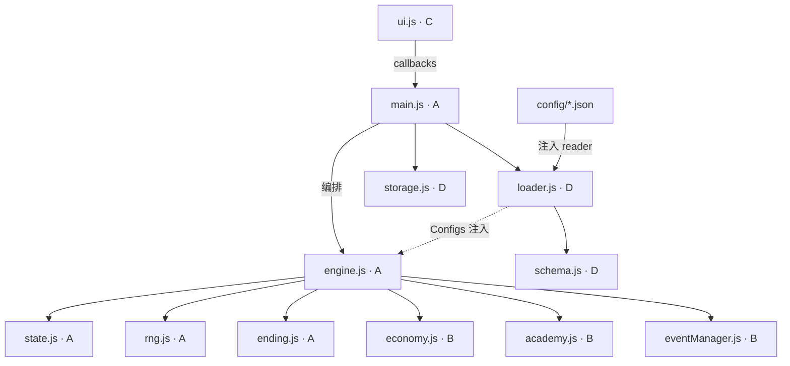

# SCUSim 实现任务分解（架构师交付 · 高见远）

> 输入：阶段 0 已冻结的 `docs/开发方案.md`、`DATA_DICTIONARY.md`、`INTERFACES.md`、`协作规范与交付流程.md` + 6 份 `config/*.json` + `src/config/schema.js` + `tests/smoke.mjs` + `server.js`（均已完成）。
> 范围：仅出设计与实现顺序/验收点，**不写任何游戏逻辑代码**。
> 目标读者：工程师（A/B/C/D 四人 + AI Eng 寇豆码），可直接照做。

---

## 1. 实现方案概要

**框架选型：原生 ECMAScript 2020 ES Modules，无前端框架、无打包器、经 HTTP 运行（`http://localhost:5173`，禁 `file://`）。**

为何不引入 Vue/React 等框架：

1. 课程项目 + 单机静态：无组件状态库/路由需求，UI 是"单页多视图 + 事件弹窗"，原生 DOM 操作足够。
2. 零运行时依赖是硬红线：`package.json` 只含 `dev`/`test` 脚本；Cloudflare Pages 部署选 None 预设、Build 留空。
3. 配置驱动 + 可复现是核心架构目标：数值全部在 `config/*.json`；随机数唯一入口 `rng.js`；可变状态 + 明确所有权。
4. 依赖单向、可 Node 测试：纯逻辑层不碰 `window`/`indexedDB`/`localStorage`/`fetch`，可在 Node 直接 import 跑冒烟。
5. 四人并行契约已冻结：接口签名锁定于 `INTERFACES.md`，先实现最小可运行循环再逐步填充数值平衡。

已冻结 5 项架构决策：①`schema.js` 与 `loader.js` 分离；②可变状态 + 明确所有权；③配置相对路径 + `import.meta.url` + 可注入 reader；④`rngState` 序列化进 `GameState`；⑤版本不兼容直接拒绝。

---

## 2. 有序文件清单（相对路径）

| 相对路径 | 归属 | 阶段 | 状态 |
|---|---|---|---|
| `docs/开发方案.md` | 全员 | 0 | ✅已完成 |
| `docs/DATA_DICTIONARY.md` | 全员 | 0 | ✅已完成（待回填） |
| `docs/INTERFACES.md` | 全员 | 0 | ✅已完成（冻结） |
| `docs/协作规范与交付流程.md` | 主理人 | 0 | ✅已完成 |
| `docs/架构任务分解.md` | 主理人 | 0 | ✅本文件 |
| `config/balance.json` | D/B | 0 | ✅已完成（部分占位） |
| `config/colleges.json` | D/B | 0 | ✅已完成 |
| `config/tags.json` | D/B | 0 | ✅已完成 |
| `config/actions.json` | D/B | 0 | ✅已完成 |
| `config/events.json` | D/B | 0 | ✅已完成 |
| `config/endings.json` | D/B | 0 | ✅已完成 |
| `src/config/schema.js` | D | 0 | ✅已完成 |
| `tests/smoke.mjs` | D | 0 | ✅已完成（阶段3扩展） |
| `server.js` / `package.json` | D | 0 | ✅已完成 |
| `css/style.css` | C | 0 | ✅已完成（设计基座） |
| `index.html` | C | 1 | ⏳待完善 |
| `README.md` | D | 1→3 | ⏳待完善 |
| `src/core/rng.js` | **A** | 1 | ⏳待写 |
| `src/core/state.js` | **A** | 1 | ⏳待写 |
| `src/core/economy.js` | **B** | 1 | ⏳待写 |
| `src/core/academy.js` | **B** | 1 | ⏳待写 |
| `src/events/eventManager.js` | **B** | 1 | ⏳待写 |
| `src/core/ending.js` | **A** | 1 | ⏳待写 |
| `src/core/engine.js` | **A** | 1→2 | ⏳待写 |
| `src/config/loader.js` | **D** | 1 | ⏳待写 |
| `src/storage/storage.js` | **D** | 1 | ⏳待写 |
| `src/ui/ui.js` | **C** | 1 | ⏳待写 |
| `src/main.js` | **A** | 2 | ⏳待重写 |

---

## 3. 依赖关系图（模块单向依赖）



**依赖红线**：`core/`、`events/`、`config/` 禁止 import `storage/`、`ui/`；禁止访问 `window`/`indexedDB`/`localStorage`/`document`。`loader.js` 的 `fetch(import.meta.url)` 是唯一允许的浏览器 API（可被注入 reader 替换以便 Node 测试）。仅 `main.js` 同时接触 engine+storage+ui。`core/events` 禁止 `Math.random`。`config` 不主动 import 任何 core 模块，由 `main` 加载后作为参数注入。

---

## 4. 任务列表（有序 · 含依赖 · 实现顺序）

### T1 · A：随机数 + 状态工厂
- 目标文件：`src/core/rng.js`、`src/core/state.js`
- 实现接口：
  - `createRng(seed) -> { next():number, int(min,max):number, chance(p):boolean, pick(arr):any, getState():number, setState(s):void, fork():Rng }`（Mulberry32）
  - `createGameState(options:{name,gender,collegeId,attributes,tags,seed?}) -> GameState`
  - `clone(state) -> GameState`（优先 `structuredClone`，降级 `JSON`）
- **G2 验收**：
  - 复现：`createRng(42)` 两实例产生完全相同 `next()` 序列。
  - 边界：`next()∈[0,1)`；`int(1,6)∈[1,6]`；`chance(0)===false`、`chance(1)===true`；`pick` 返回其中一项。
  - 序列化：`s=getState()`；`setState(s)` 后序列一致。
  - `fork()` 返回独立子发生器（父/子各 next 一次后分叉）。
  - `createGameState({name:'张三',gender:'男',collegeId:'cs',attributes:{knowledge:5,social:5,health:5,money:5},tags:['study_hard','gamer','chill'],seed:7})`：`version==='1.0.0'`、`seed===7`、`turn===1`、`actionPoints===4`、`academics==={semesterScores:[],failedCourses:0,warning:false,studyActions:0}`、`pendingEvent===null`、`eventHistory===[]`、`log===[]`、`endingId===null`、`player` 深等于入参、`rngState` 存在。
  - `clone(s).player !== s.player` 且 `JSON.stringify(clone(s))===JSON.stringify(s)`。
  - 静态：`src/core/` 无 `Math.random`/`indexedDB`/`localStorage`/`window.`。

### T2 · B：规则模块（经济/学业/事件）
- 目标文件：`src/core/economy.js`、`src/core/academy.js`、`src/events/eventManager.js`
- 实现接口：
  - `economy.js`：`applyActionEconomy(state, action, config, rng) -> void`；`monthlyEconomy(state, config) -> void`
  - `academy.js`：`takeExam(state, config, rng) -> { ok, score, passed }`；`checkWarning(state) -> boolean`
  - `eventManager.js`：`rollRandomEvent(state, config, rng) -> { eventId:string|null, options }`；`checkFixedEvents(state, config) -> string[]`；`resolveEvent(state, eventId, choiceId, config, rng) -> { ok, result?, message? }`
- **G2 验收**：
  - `applyActionEconomy`：`actions.json` 的 `study`（effects `{knowledge:2,health:-1}`）后 `knowledge+2`、`health-1`。
  - `monthlyEconomy`：读 `balance.monthlyIncome`/`monthlyExpense`（缺省按 0）；配置 200/150 时 `money+50`，缺省不变不报错。
  - `takeExam`：公式 `score = base + knowledgeWeight*knowledge + studyBonusPerAction*studyActions - difficulty`（取 `balance.exam`）；`knowledge=10,studyActions=0,base=60,weight=1,diff=10 → score=60`；`passed=score>=passLine(60)`；夹取 `[0,100]`；`!passed` 时 `failedCourses+1`。
  - `checkWarning`：`failedCourses>=3 → true 且 warning===true`；`failedCourses=2 → false`。
  - `rollRandomEvent`：Mock Rng（chance 恒 true）返回 `events.random` 中某 `eventId` + `options`；恒 false 返回 `{eventId:null}`。
  - `checkFixedEvents`：`turn===1 → ['ev_fixed_club_recruit']`；`turn===38 → ['ev_fixed_thesis']`；其余 `[]`；已存在 `eventHistory` 的固定事件不再返回。
  - `resolveEvent`：`ev_fixed_club_recruit` 选 `join` → `social+3`，返回 `{ok:true,...}`；无效 `choiceId → {ok:false, reason}`。
  - 静态：`src/core/`、`src/events/` 无 `Math.random`/DOM/存储引用。

### T3 · C：UI 表现层（可先用 Mock 回调）
- 目标文件：`src/ui/ui.js`、`index.html`
- 实现接口：`createApp({config, callbacks}) -> { mount(rootEl), render(state, view?), showEvent(ev), showEnding(e), showError(msg), showGallery(g) }`
  - `callbacks`: `onNewGame(options), onLoadGame(), onAction(actionId), onAdvance(), onResolveEvent(choiceId), onExport(), onImport(file), onClearSave(), onOpenGallery(), onOpenSettings()`
- **G2 验收**：
  - `mount` 渲染主菜单（新游戏 / 继续[无存档时禁用] / 图鉴）。
  - 四步创建流：姓名→性别→学院（config.colleges）→分配 20 点属性→选 3 标签（config.tags）；`render` 反映 `turn`/`actionPoints`/四属性/`semester=Math.ceil(turn/5)`。
  - 行动按钮禁用态由 `render(state, {availability})` 传入；点击可用按钮触发 `callbacks.onAction(actionId)`；UI 自身不调引擎、不改 state。
  - `showEvent(ev)` 渲染 `ev.options`，点击触发 `callbacks.onResolveEvent(optionId)`。
  - `showEnding(e)` 渲染结局 + 返回主菜单；`showError(msg)` 不崩；`showGallery(g)` 列 `g.unlocked`。
  - 代码评审：`ui.js` 不 import `core`/`events`/`storage`；所有状态变更经 `callbacks`。

### T4 · D：配置加载 + 存储
- 目标文件：`src/config/loader.js`、`src/storage/storage.js`、`README.md`
- 实现接口：
  - `loader.js`：`loadConfig(reader?) -> Promise<Configs>`（`Configs={balance,colleges,tags,actions,events,endings}`；默认 `fetch(new URL('../config/'+path, import.meta.url))`；内部调 `validateConfigs`；失败抛 `{ok:false,reason,errors[]}`）
  - `storage.js`：`saveGame(state)`,`loadGame()`,`clearSave()`,`getGallery()`,`unlockEnding(id)`,`exportSaveFile(state)->Promise<Blob>`,`importSaveFile(file)->Promise<{ok,state?,reason?}>`,`getSettings()`,`saveSettings(settings)`
- **G2 验收**：
  - `loadConfig(reader)` 注入 reader（Node）返回含 6 key 对象且 `validateConfigs` ok；故意删 `colleges` → reject 且 `errors` 非空。
  - 默认路径（浏览器手测）：6 份 JSON 均成功加载。
  - `saveGame(s)` 后 `loadGame()` 返回 `state` 且 `turn`/`player.name` 一致（IndexedDB；不可用降级 localStorage 并提示）。
  - `exportSaveFile` 产出 `Blob`，内容 `{format:'scusim',version,state}`；`importSaveFile` 该 Blob → `{ok:true, state}` 且 `turn` 一致。
  - `importSaveFile` 畸形 → `{ok:false,reason}` 且不覆盖当前存档。
  - 版本不兼容（如 `version:'9.9.9'`）→ `{ok:false,reason}` 拒绝。
  - `getGallery()` 初始 `{version, unlocked:[]}`；`unlockEnding('ending_ordinary')` 后 `unlocked` 含之且去重；`getSettings()` 默认 `{seedDisplay:false,reduceMotion:false,lastSaveAt:0}`，`saveSettings` 合并写入。
  - 静态：`loader.js` 仅用 `fetch`/`import.meta.url`，不含 `document`/`indexedDB`/`localStorage` 之外的 DOM。
  - **Node 可测性**：将纯序列化逻辑（`serializeSave`/`deserializeSave`/版本校验/图鉴去重）导出为纯函数，使 `smoke.mjs` 不依赖 DOM 即可测存档往返。

### T5 · A：核心引擎 + 结局（集成 B 规则）
- 目标文件：`src/core/engine.js`、`src/core/ending.js`
- 实现接口（均就地改 state，返回统一结果对象）：
  - `newGame(options, config, rng) -> {ok, state, message?}`
  - `actionAvailability(state, actionId, config) -> {ok, reason?}`
  - `doAction(state, actionId, config, rng) -> {ok, state, message?, reason?}`
  - `advance(state, config, rng) -> {ok, state, settlement?, pendingEvent?, endingId?, message?}`
  - `resolvePendingEvent(state, choiceId, config, rng) -> {ok, state, result?, message?, reason?}`
  - `getEnding(state, config) -> {ok, endingId:string|null}`
  - `ending.js`：`evaluateEnding(state, config) -> string|null`
- **G2 验收**：
  - `newGame`：合法 → `{ok:true, state}`、`turn===1`、`actionPoints===4`、`state.rngState===rng.getState()`；`attributes` 四项之和≠20 → `{ok:false, reason:'attributes'}`；缺 `collegeId`/非法 `tags` → `{ok:false, reason}`。
  - `actionAvailability`：`actionPoints>=cost` 且 `health >= action.requiresHealth` → `{ok:true}`；`AP<cost → {ok:false,reason:'AP'}`；`health<requiresHealth → {ok:false,reason:'health'}`。
  - `doAction`：`doAction('study')` → `AP 4→3`、`knowledge+2`、`health-1`、`log` 追加；`AP===0 → {ok:false,reason:'AP'}` 且 state 不变；健康受限 → `{ok:false,reason:'health'}` 且不变；`actionId==='study'` 时 `academics.studyActions+1`。
  - `advance`：`AP` 耗尽后 `advance()` → `turn+1`、`actionPoints` 重置 4；`semester=Math.ceil(turn/5)`；`examTurns` 中回合调 `takeExam` 并 `semesterScores.push`、`checkWarning`；固定/随机事件可能写 `pendingEvent`（同刻至多一个）；`turn` 不越过 40；终局回合置 `endingId`。断言：跑完 40 回合 `turn` 停在 40 且 `endingId` 非空。
  - `resolvePendingEvent`：有效 `choiceId` → 应用效果、清空 `pendingEvent`、写 `eventHistory`；无效 → `{ok:false, reason}`。
  - `getEnding`/`evaluateEnding`：`knowledge>=30 → 'ending_academic_star'`（priority 100）；多命中取最高优先级；仅 `warning` 命中 → `'ending_warning'`；全不中但 `default` 存在 → `'ending_ordinary'`（priority 1）。
  - **复现性**：固定 seed，`newGame+doAction+advance` 全程同 rng → 同种子同输入完全一致（冒烟断言）。

### T6 · A：协调层集成（阶段2 端到端）
- 目标文件：`src/main.js`（重写 stub）
- 职责：启动 `loadConfig()` → `createApp({config, callbacks})` → 绑定回调 → `loadGame()` 有存档则启用"继续"。回调串接 engine+storage+ui。
- **G2→G3 验收**：浏览器完整跑通创建→行动→推进→事件→结局；刷新恢复存档；导出/导入 `.scusim`；图鉴跨周目保留；UI 不直接改 state（代码评审）。

### T7 · D：文档/部署/冒烟收尾（阶段3）
- 目标文件：`README.md`、`tests/smoke.mjs`（扩展）
- `smoke.mjs` 扩展（Node 无浏览器）：①`loadConfig` 加载 6 配置；②`newGame`+固定种子跑满 40 回合不越界不抛错；③同种子同输入两次一致；④`.scusim` 序列化/反序列化关键字段一致（纯 JSON，不依赖 IndexedDB）；⑤保留原静态约束扫描。
- **G4 验收**：`npm test` 全绿；Pages 预览可打开；控制台无阻断错误。

---

## 5. 共享知识（跨文件约定）

### 5.1 RNG 接口（唯一随机入口）
```js
createRng(seed:uint32) -> {
  next(): number, int(min,max): number, chance(p): boolean,
  pick(arr): any, getState(): number, setState(s:number): void, fork(): Rng
}
```
Mulberry32；`core/events` 严禁 `Math.random`。

### 5.2 GameState 形状（可变；core 独占写）
```js
{
  version: "1.0.0", seed: number, rngState: number,
  turn: 1, actionPoints: 4,
  player: { name, gender:'男'|'女', collegeId,
            attributes:{knowledge,social,health,money}, tags:[a,b,c] },
  academics: { semesterScores:[], failedCourses:0, warning:false, studyActions:0 },
  pendingEvent: { eventId, options:[{id,label}] } | null,
  eventHistory: [], log: [], endingId: null
}
// 派生：semester = Math.ceil(turn/5)；month = turn
```

### 5.3 统一结果对象
- 成功：`{ ok:true, state?, data?, message? }`
- 失败：`{ ok:false, reason:string, data? }`

### 5.4 config 注入
`main` 调 `loadConfig()` 得 `Configs`，作为 `config` 参数传入 engine 各函数；引擎透传给 `economy/academy/eventManager`。`config` 是被传入的数据，不是被 import 的模块。

### 5.5 存档序列化（含 rngState）
```json
{ "format":"scusim", "version":"1.0.0",
  "state": { "version","seed","rngState","turn","actionPoints","player","academics","pendingEvent","eventHistory","log","endingId" } }
```
导入：格式/版本/state 合法 → 还原后 `rng.setState(state.rngState)`；版本不兼容直接拒绝不覆盖。图鉴 `gallery={version,unlocked:[]}` 与存档独立 key，跨周目保留。

### 5.6 红线速记
原生 ES2020 / 无框架 / 无打包 / HTTP；`core/events/config` 禁 DOM·IndexedDB·LocalStorage；随机唯一入口 `rng.js`；数值全配置；UI 只走 callbacks 不改 state；仅 `main` 串联。

---

## 6. 待明确事项（阻塞歧义的"安全占位"——并行实现用）

1. **属性初始基线**：从 0 起分配 20 点（`attributes` 四项和严格===20 作为 `newGame` 校验硬约束）；`healthRestrictThreshold=3` 已配置；`actionAvailability` 仅在 `health < action.requiresHealth` 时禁用该行动。
2. **月度经济参数缺失**：`monthlyEconomy` 读 `balance.monthlyIncome`/`monthlyExpense`，缺省按 0（no-op）；B 后续补字段。
3. **`studyActions` 计数器**：`academics.studyActions:number`（默认 0，持久化）；`doAction('study')` 时 +1；`takeExam` 读取。
4. **随机事件权重修正**：v1 先降级为原始 `weight` 等概率抽样；`weightModifiers` 预留。
5. **结局 condition 类型**：v1 仅 `attributeAtLeast`/`warningTrue`/`default`；未知 type 视为不命中并记日志；恋爱结局不纳入 v1。

> 以上 5 项在团队拍板前按占位实现即可打通最小可运行循环；结论回填文档后 B/D 再回填数值与字段校验，不影响接口签名。
